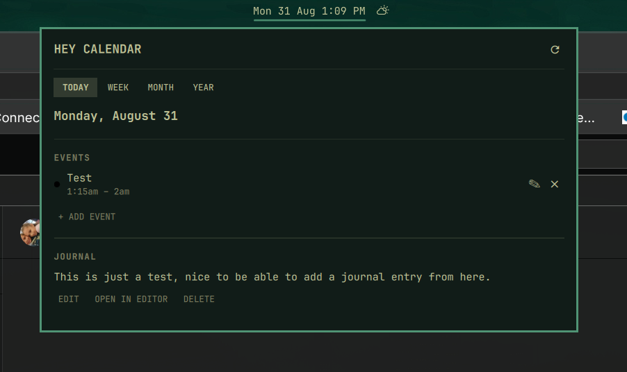
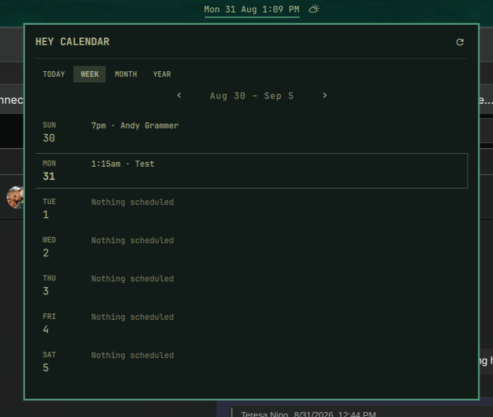
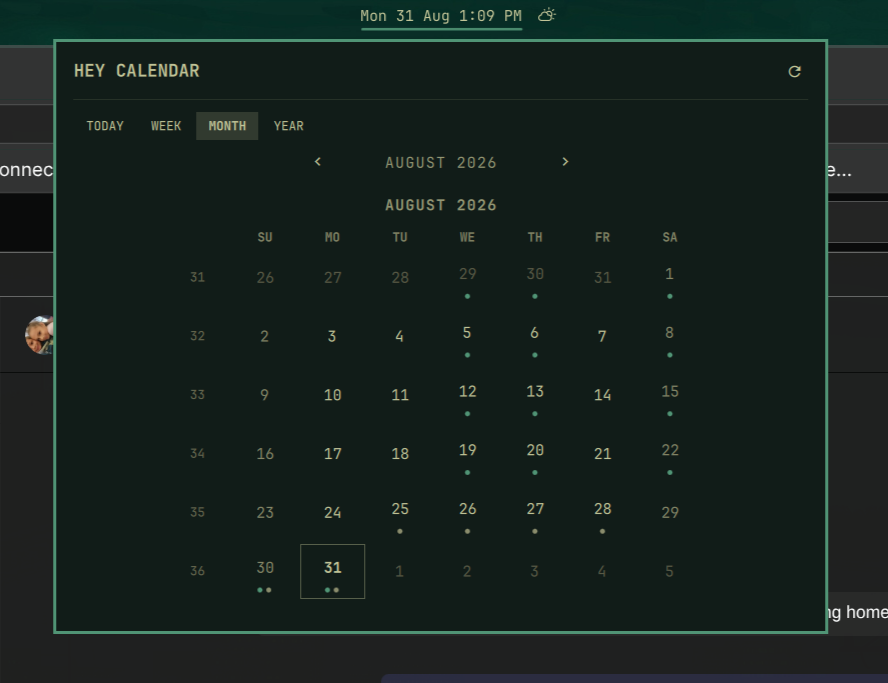
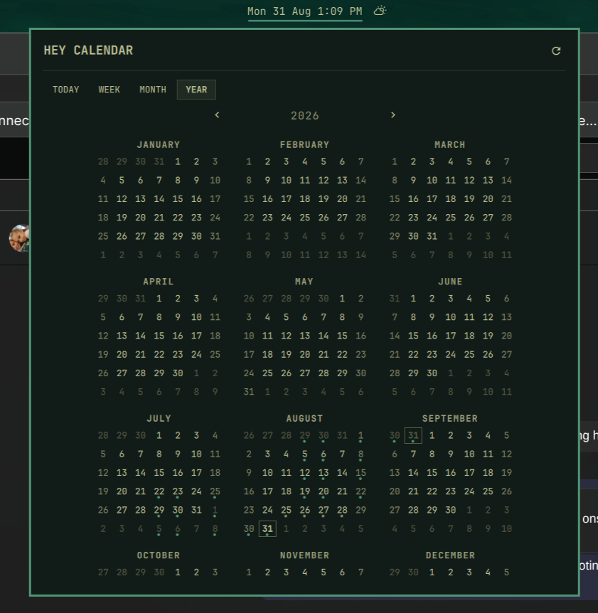

# HEY Calendar for Omarchy

A native Omarchy bar widget and panel for your [HEY](https://hey.com) calendar
and journal — Today, Week, Month, and Year views, with a day-by-day panel for
reading and editing events and journal entries, all driven by the `hey` CLI.
Built to match the look, spacing, and interaction feel of Omarchy's own
`omarchy.clock` widget and the official `37signals.hey` plugin, so it feels
like a stock part of the shell rather than a bolted-on extra.

<table>
<tr>
<td width="50%"></td>
<td width="50%"></td>
</tr>
<tr>
<td width="50%"></td>
<td width="50%"></td>
</tr>
</table>

## What it does

- **Bar chip** — shows today's date, or your next upcoming event when one's
  still ahead today. Right-click cycles through several date/time layouts
  (see [Bar label](#bar-label--right-click-to-cycle) below).
- **Click the chip** to open the panel, with four views:
  - **Today** — the full day, right there: events and your journal entry, no
    extra click.
  - **Week** — seven days at a glance, a few events per day.
  - **Month** — a grid matching Omarchy's own calendar popup exactly (same
    week numbering, same "always six rows" layout), with a small dot under
    any day that has an event or a journal entry.
  - **Year** — all twelve months at once, compact, click through to any day.
- **Click any day** (in Week, Month, or Year) to open that day's detail:
  - See its events, color-dotted by which HEY calendar they're on.
  - Add an event — title, time (typed however you'd naturally type it —
    `9:00`, `9:30am`, `21:30` all work), optional location, optional
    calendar.
  - Edit or delete an event inline.
  - Read the day's journal entry as plain text (HEY stores these as HTML;
    this always shows the readable version).
  - Quick-edit the journal entry inline, or hand a longer entry off to your
    `$EDITOR` in a floating terminal.
- **Setup built in** — if the HEY CLI isn't installed or isn't signed in, the
  panel shows the same one-click install/sign-in flow as the official HEY
  email plugin, instead of just failing quietly.

## Requirements

- Omarchy (Quickshell-based bar).
- The [HEY CLI](https://hey.com) (`hey`), installed and signed in. If it
  isn't, the panel will offer to install it (`omarchy pkg aur add hey-cli`)
  and sign in (`hey auth login`) the first time you open it.

## Install

```sh
omarchy plugin add https://github.com/ninepointlabs/omarchy-hey-calendar.git --enable
```

That clones the plugin into `~/.config/omarchy/plugins/ninepointlabs.hey-calendar`
and turns it on. To update it later:

```sh
omarchy plugin update ninepointlabs.hey-calendar
```

### Installing from a local checkout instead

If you're working from a clone of this repo rather than installing from
GitHub (e.g. `~/Projects/omarchy-hey-calendar`, this project's own
convention for where plugin source lives):

```sh
cp -r ~/Projects/omarchy-hey-calendar ~/.config/omarchy/plugins/ninepointlabs.hey-calendar
omarchy plugin validate ~/.config/omarchy/plugins/ninepointlabs.hey-calendar
omarchy plugin enable ninepointlabs.hey-calendar
```

Use a real copy, not a symlink back into `~/Projects` — Omarchy's plugin file
watcher doesn't follow a symlinked plugin directory, so edits there won't
hot-reload.

## Uninstall

```sh
omarchy plugin disable ninepointlabs.hey-calendar   # turn it off, keep the files
omarchy plugin remove ninepointlabs.hey-calendar     # turn it off and delete the files
```

Disabling just removes it from the bar; your HEY data is untouched either
way — nothing this plugin does lives anywhere but your HEY account.

## Positioning: moving it, centering it, anchoring it

By default the widget lands in the bar's right section. To move it:

```sh
# Move to the center section, as the first item there
omarchy bar move ninepointlabs.hey-calendar --section center --index 0

# Or use put (same idea, different phrasing) to place it relative to another widget
omarchy bar put ninepointlabs.hey-calendar --after omarchy.clock
```

You can also just drag it to a new spot directly in the bar.

### Anchoring it to the true center

Omarchy's bar supports pinning **one** widget in the center section to the
exact horizontal center of the screen, with everything else in that section
flowing around it — this is what keeps it from sliding sideways as other
center-section widgets change width. Set it in
`~/.config/omarchy/shell.json`, under the top-level `bar` key:

```json
{
  "bar": {
    "centerAnchor": "ninepointlabs.hey-calendar"
  }
}
```

Set `centerAnchor` to `""` to go back to the center section just being
centered as a group. This is a shell-wide setting — only one widget can be
the anchor at a time, so setting a different one for the calendar replaces
whatever was anchored before (`omarchy.clock`, most commonly).

**One thing worth knowing:** the bar chip's own width still changes with
what it's showing — "Mon 31 Aug" is shorter than a next-event line like
"5:15pm · Tae Kwon Do", and time-inclusive formats change length every
minute. `centerAnchor` keeps the widget's own center point fixed as that
happens, but the widget itself still visibly grows and shrinks in place. If
you want it to hold a completely constant width, turn off "Show next event
in bar" in its settings and pick a fixed-width date format (a `ddd d MMM`
style format stays the same length year-round; a format with a bare `d` or
`h` will vary by a character between single- and double-digit days/hours).

## Settings

Opened via the panel's settings (or set directly in `shell.json` under the
widget's entry):

| Key | What it does | Default |
|---|---|---|
| `showNextEvent` | Show the next event's time and title in the bar instead of the date, when one's still ahead today | `true` |
| `view` | Which view opens by default: `today`, `week`, `month`, or `year` | `month` |
| `format` / `verticalFormat` | The current bar label format (see below) — normally set by right-clicking, not by hand | `ddd d MMM` |

## Bar label — right-click to cycle

Right-click the bar chip to step through a ring of layouts, the same
interaction as the stock clock widget:

`Mon 31 Aug` → `Monday, August 31` → `31 Aug 2026` → `Aug 31` →
`Mon 31 Aug 14:05` → `Mon 31 Aug 2:05 PM` → `14:05` → `2:05 PM` → *(back to the start)*

The choice is written back to `shell.json`, so it persists across restarts.
Vertical bars (left/right-docked) get their own shorter set of two-line
layouts.

## Keyboard

With the panel open:

| Key | Action |
|---|---|
| `1` `2` `3` `4` | Jump to Today / Week / Month / Year |
| Arrow keys | Step the current view (previous/next month, week, or year) |
| `t` | Jump back to today |
| `r` | Refresh |
| `Esc` | Close the day detail, then the panel |
| `Tab` / `Shift+Tab` | Switch to the next/previous bar panel |

## Under the hood

For anyone extending this plugin:

- **`Service.qml`** is the shared data layer — one instance per shell, so
  every monitor's bar widget and every open panel shares one set of `hey`
  calls rather than each running its own. It probes the CLI's install/auth
  state the way `37signals.hey` does, fetches whichever date window the
  active view needs (`hey event list` / `hey journal list`, both accepting
  `--starts-on`/`--ends-on`), probes the system's real timezone once via
  `/etc/localtime` (`hey event add/edit` does not reliably resolve "this
  machine's zone" on its own — see the comment above
  `Model.eventAddCommand`), and serializes event/journal writes one at a
  time.
- **`Model.js`** is pure JS: date/grid math (adapted from `omarchy.clock`, so
  the Month and Year views line up exactly with the native calendar popup),
  `hey` command builders and response parsing (including flattening HEY's
  HTML-stored journal entries to plain text), and the same bounded-output,
  timeout-guarded process wrapper `37signals.hey` uses so a hung or
  oversized `hey` call can't wedge the shell.
- **`Panel.qml`** renders the Month and Year grids directly inline rather
  than through a shared reusable component. That's a deliberate workaround:
  on this Quickshell build, a locally-defined `.qml` component instantiated
  with more than roughly two properties assigned onto it from the outside
  silently loses every assignment past the second, with only a
  `Cannot assign to non-existent property` warning naming whatever came
  third or later — no fatal error, just a component that never fully
  constructs. Confirmed empirically across many isolated tests before
  landing on inlining as the reliable fix; see the git history around the
  "panel never opens" fix for the full trail if you hit something similar
  in your own plugin.
- **`DayDetail.qml`** is the day's content — used embedded for Today, and as
  an overlay's content everywhere else, both driven from the same file.

See `THIRD_PARTY_NOTICES.md` for the specific code adapted from Omarchy's
built-in clock plugin and from `37signals.hey`.

## Known limitations

- Recurring events show only on the single occurrence the HEY CLI returns
  for a given window (it lists a series once, not per-occurrence) — no
  local RRULE expansion.
- Moving an event to a different day isn't exposed in the form (the CLI
  supports it via `hey event edit <id> <new-date> ...`; just not wired into
  this UI yet).
- No per-calendar visibility toggle — every calendar's events show, each
  color-dotted by its own calendar.
- "Open in editor" hands off to `hey journal write DATE`, which opens your
  `$EDITOR` on the entry as HEY has it stored — since HEY stores journal
  entries as HTML internally, that buffer may show raw markup rather than
  plain text. The inline "Edit" button in the day panel is the guaranteed
  plain-text path; reach for "Open in editor" only for something longer
  where you're comfortable with your `$EDITOR`'s own formatting.
- Week start follows the system locale; there's no in-panel toggle for it
  the way the clock popup's "W" click has.
